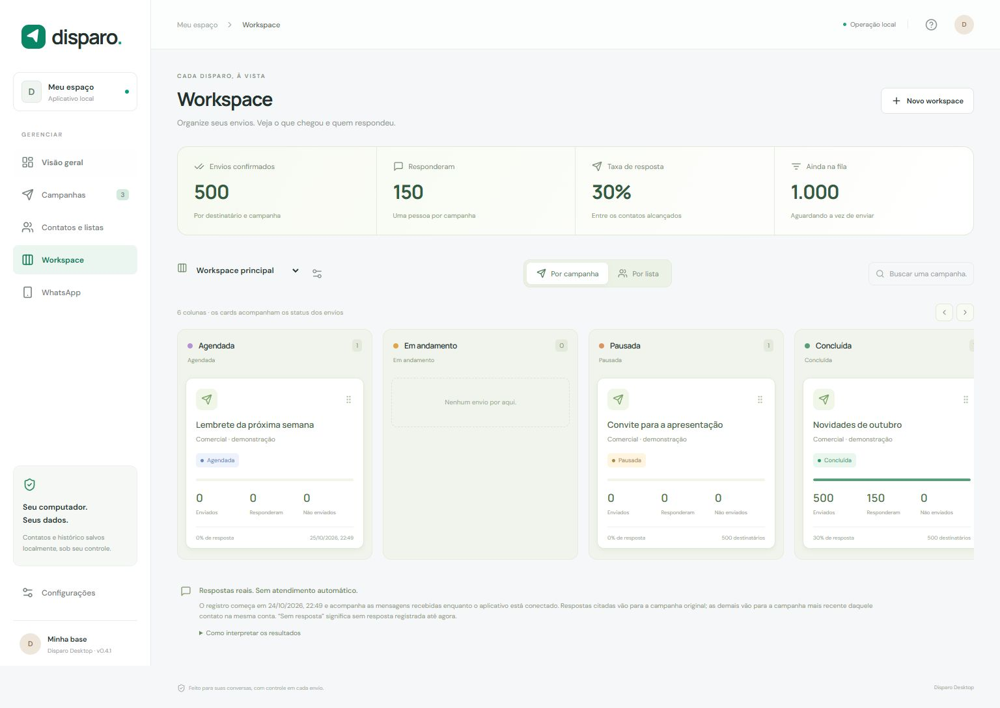

# Disparo

[](https://github.com/iacomexcelencia-rgb/disparo/actions/workflows/ci.yml)
[](LICENSE)

Sua base, suas campanhas e cada resposta, em um aplicativo local para Windows.

O Disparo conecta ao seu WhatsApp pelo QR code para organizar contatos, enviar textos e imagens, agendar campanhas e acompanhar resultados. Os dados ficam no seu computador.



## Novidades da versão 0.5.0

Agora você pode **editar uma campanha antes do primeiro envio** e **excluir campanhas pelo modal**, tanto em Campanhas quanto no Workspace. Ajuste mensagem, destinatários, anexos e horário, mantendo o status atual. A exclusão pede confirmação e preserva os contatos e as mensagens que já estão no WhatsApp.

Veja os detalhes no [histórico de versões](CHANGELOG.md) ou baixe o código na [Release 0.5.0](https://github.com/iacomexcelencia-rgb/disparo/releases/tag/v0.5.0).

## O que você encontra

- **Visão geral:** base, campanhas e resultados dos envios.
- **Campanhas:** mensagens personalizadas, até cinco anexos, agendamento, edição antes do primeiro envio, exclusão, pausa, retomada e relatório CSV.
- **Contatos e listas:** cadastro, edição e importação de Excel, CSV e vCard, combinando telefones repetidos.
- **Workspace:** Kanban por campanha ou por lista, colunas configuráveis e cards com detalhes dos envios e respostas.
- **WhatsApp:** conexão por QR code e sessão salva localmente.

## Instalar e abrir

Você precisa de **Node.js 22.12 ou superior**, npm e **Google Chrome ou Microsoft Edge** instalado. O aplicativo desktop é destinado ao Windows.

Baixe o código em **Code → Download ZIP** ou clone este repositório. Extraia o arquivo e abra um terminal na pasta do projeto:

```powershell
npm ci
npm run build
npm run desktop
```

Depois da instalação, também é possível abrir pelo arquivo `INICIAR.cmd`.

Para usar no navegador:

```powershell
npm start
```

Abra **http://127.0.0.1:4317**. A primeira instalação pode levar alguns minutos para baixar as dependências.

## Atualizar preservando seus dados

1. Feche o Disparo e seu servidor local.
2. Faça uma cópia da pasta de dados indicada em **Configurações**. Ao executar pelo código, o padrão é `.data/`.
3. Se instalou com Git, atualize e recompile:

```powershell
git pull --ff-only
npm ci
npm run build
npm run desktop
```

Se instalou pelo ZIP, extraia a nova versão em outra pasta, copie sua pasta `.data/` para essa nova instalação e execute os comandos de instalação. Se usa `DISPARO_DATA_DIR`, mantenha o mesmo caminho da base. Abra apenas uma instalação usando essa pasta de dados por vez.

A versão 0.5.0 mantém o formato dos dados locais. Ao reabrir, confira a conexão do WhatsApp e as campanhas agendadas antes de retomar campanhas pausadas. O backup contém informações privadas e deve permanecer fora do repositório público.

## Primeira campanha

1. Abra **WhatsApp**, adicione sua conta e leia o QR code em **Aparelhos conectados**, no celular.
2. Cadastre ou importe sua base em **Contatos e listas**.
3. Crie uma campanha, escolha os destinatários, escreva a mensagem e adicione seus arquivos.
4. Revise as mensagens e confirme o envio, ou escolha um agendamento.
5. Acompanhe a fila em **Campanhas** ou **Workspace**. Continue atendendo pelo próprio WhatsApp.

### Personalização e anexos

Use `{{primeiro_nome|tudo bem}}`, `{{nome|pessoal}}` ou `{{empresa|sua empresa}}`. O texto depois de `|` é usado quando o campo está vazio. As colunas extras importadas também ficam disponíveis.

`{Olá|Oi|Bom dia}` escolhe uma variação ao salvar o rascunho. A revisão mostra o texto definitivo de cada destinatário.

Cada campanha aceita até **cinco arquivos de até 25 MB cada**. Texto e anexos são mensagens separadas. Os limites contam cada mensagem, e o status considera todas as partes do envio.

### Fila e confirmações

O intervalo entre destinatários vale para a conta inteira, inclusive na troca de campanha. Os limites por hora e por 24 horas são compartilhados pelas campanhas da mesma conta e permanecem registrados após reiniciar.

- **Pendente:** ainda na fila.
- **Aguardando confirmação:** identificada no WhatsApp, sem confirmação do servidor.
- **Enviada / Entregue / Lida:** confirmação correspondente recebida para todas as partes, quando disponibilizada pelo WhatsApp.
- **Não enviada:** número indisponível ou falha explícita.
- **Conferir envio:** resultado incerto ou entrega parcial. O sistema registra o caso, segue para o próximo contato e não reenvia automaticamente.

Mantenha o computador ligado, sem suspensão, com internet e o aplicativo aberto. Fechar o aplicativo pausa campanhas em execução. Uma mensagem que já começou a ser enviada pode terminar mesmo após pausar ou cancelar a campanha.

### Workspace e respostas

Escolha **Por campanha** ou **Por lista**. Os cards acompanham o status real e abrem modais com resumo, mensagens, anexos, destinatários, falhas, fila e respostas recebidas.

As colunas de fábrica são **Rascunho / sem campanha**, **Agendada**, **Em andamento**, **Pausada**, **Concluída** e **Cancelada**. Você pode renomear, reordenar, adicionar colunas e criar outros workspaces. Arrastar um card organiza o quadro sem alterar os envios; quando o status real muda, ele volta a acompanhar a coluna correspondente.

O aplicativo registra respostas recebidas pela sessão conectada, contando cada pessoa uma vez por campanha. Uma resposta citando a mensagem original pertence àquela campanha; sem citação, ela é associada ao último envio tentado para o mesmo contato pela mesma conta. Cada resposta pertence a apenas uma campanha.

No modal da campanha, em **Campanhas** ou no **Workspace**, use **Editar campanha** para alterar nome, conta, destinatários, mensagem, anexos, horário e limites antes do primeiro envio. A edição mantém o status atual: uma campanha agendada continua agendada; um rascunho ou uma campanha pausada não começa a enviar ao salvar. Para retirar o agendamento de uma campanha já aprovada, pause-a primeiro.

**Excluir campanha** pede confirmação e remove seus resultados e respostas dos relatórios, preservando os contatos e as mensagens que já estão no WhatsApp. Um envio em andamento precisa terminar antes da exclusão. Os envios das últimas 24 horas continuam contando para os limites da conta, mesmo depois de excluir a campanha.

**Exemplo:** 500 destinatários com envio confirmado e 150 respondentes resultam em **150 responderam**, **350 sem resposta registrada** e **30% de resposta**. Quem ainda está na fila não entra como alguém que nunca respondeu. Grupos ficam fora da taxa de resposta.

Por lista, os totais somam participações em campanhas; o modal também mostra pessoas únicas. A participação na lista é salva ao criar a campanha, preservando o histórico quando você altera a base.

O registro começa quando a funcionalidade está em uso, sem buscar retroativamente o histórico do WhatsApp. Não há garantia de recuperar mensagens de períodos em que o aplicativo ficou desconectado. Uma resposta em um envio incerto registra a interação sem confirmar a entrega dos anexos.

## Dados e backup

A pasta de dados aparece em **Configurações**. Pelo código, o padrão é `.data/`; no executável distribuído, fica na pasta de dados do aplicativo do usuário do Windows.

Para fazer backup, feche o aplicativo e copie essa pasta inteira. Ela guarda contatos, listas, campanhas, workspaces, respostas, anexos e sessões conectadas. Ela é privada e está excluída do Git e da exportação do código.

O serviço escuta somente na máquina local. O projeto não exige Vercel, Supabase nem servidor na nuvem.

## Desenvolvimento

```powershell
npm run dev
npm run check
npm run test:ui
npm run test:campaigns-ui
```

`npm run check` confere a formatação, executa os testes e compila a interface. `npm run test:ui` valida o Workspace com 500 contatos fictícios. `npm run test:campaigns-ui` confere edição, exclusão e persistência, incluindo a interface em tela pequena. Os testes visuais usam transporte simulado e não enviam mensagens reais.

Para gerar o executável Windows:

```powershell
npm run pack
```

Os arquivos gerados ficam em `release/`. Para conferir e exportar apenas os arquivos publicáveis:

```powershell
npm run source:check
npm run source:export
```

O ZIP inclui código, dependências declaradas, lockfile, testes e documentação. Não inclui a base local, sessões, anexos privados, dependências instaladas nem executáveis.

Consulte [o guia de desenvolvimento](docs/DESENVOLVIMENTO.md) e [como contribuir](CONTRIBUTING.md).

## Limites da integração

A conexão usa [whatsapp-web.js](https://github.com/wwebjs/whatsapp-web.js), baseada no WhatsApp Web. Mudanças no serviço podem exigir manutenção. Os controles de intervalo não garantem ausência de restrições pelo WhatsApp. O projeto não tem vínculo com a Meta ou o WhatsApp.

## Licença

[MIT](LICENSE). As dependências mantêm suas próprias licenças.

Se o projeto for útil para você, uma estrela no GitHub ajuda outras pessoas a encontrá-lo. Contribuições são bem-vindas.
